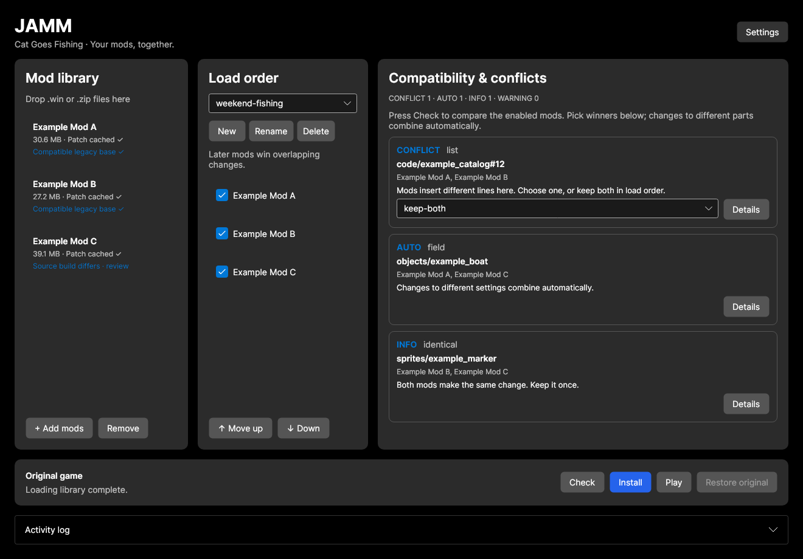
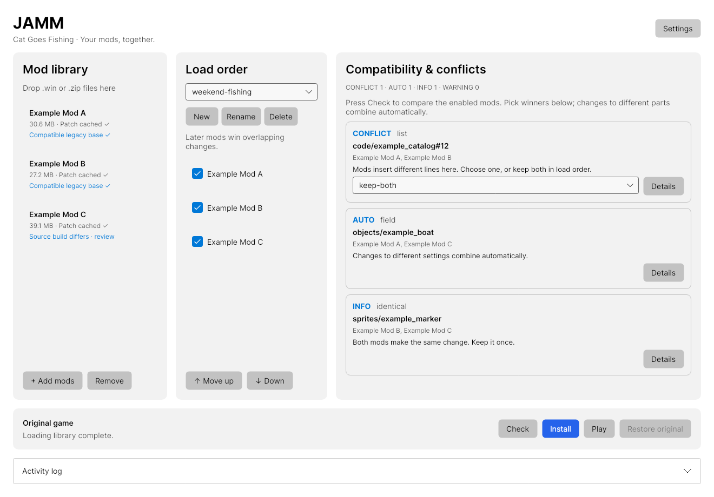

# JAMM-CGF

**Combine Cat Goes Fishing mods, review their conflicts, and install one verified game archive.**




> **Requires the legacy August 2023 game and its matching executable.** The current Steam YYC build has no mergeable bytecode. Owners can download depot **343782**, manifest **9039707068725406600**, through Steam. [Get the legacy build →](docs/legacy-version.md)

## What it does

- Browses Litterbox, resolves public Game Jolt files, and imports downloads into your local library.
- Keeps local copies of your `.win` and `.zip` mods in one library.
- Saves profiles with enabled mods, load order, and explicit conflict choices.
- Combines independent changes and explains overlapping changes before installation.
- Builds, reloads, and verifies the merged archive, with original backups and one-click restore.

## GUI quick start

1. Build from source below, or use a published `cgfmm-gui` executable when packages become available. Launch `dotnet run --project src/Jamm.Gui -c Release`.
2. Open **Settings**, choose a **separate copy of the complete legacy game folder**, and select the untouched base `data.win` outside that folder. The base must pass legacy bytecode validation. Set Wine or Proton there if you plan to play on Linux.
3. Drag `.win` or `.zip` mods into the library, or press **Add mods**. Zip files must contain exactly one `data.win`; other contents are never extracted or executed.
4. Create a profile, enable its mods, and arrange their order by dragging or using the arrow buttons. Later mods win overlaps by default.
5. Press **Check**. Review conflict explanations, use **Details** for local code, and save winners for individual hunks. Press **Install**, then confirm the exact destination and backup paths after verification.
6. Press **Play**. Use **Restore original** to return to the backed-up archive. The activity log explains errors and can be copied.

The desktop window and CLI use the same data directory and settings. Pass `--data-dir <directory>` to either, or set `CGFMM_DATA_DIR`. [Storage and runner settings](docs/data-layout.md).

## Browse mods

Open **Browse mods**, select a card to see images and check its content, then press
**Download**. JAMM imports the file and enables it in your active profile (creating a
default profile if needed). Green/grey **Disable/Enable** buttons control your mods.
Press **Play** to build, verify and apply changed selections before starting the game.
The first installation asks you to approve the exact game-copy and backup paths.

Cards show counts computed from the archives, rather than claims from descriptions.
A green check means the patch built and verified with matching build information;
a red cross means it cannot apply; a yellow question mark means unverified, failed
analysis, or a different source build. Hover the icon for the reason. Colour Expansion
builds against the August 16 base but remains yellow because its source is August 15.

**Advanced mode** is saved between sessions. It shows author descriptions, releases,
file choices, load order, conflicts and the existing manager actions. A unique file
from the newest release is chosen automatically; genuinely ambiguous choices require
the advanced picker. Later mods win by default; advanced conflict choices remain available.

First-run setup searches Steam libraries and depot downloads on Windows, Linux
(including Flatpak/Snap Steam) and macOS. A detected legacy game can be copied into
separate manager storage with one click. If only the current game is found, copy the
legacy-depot command into Steam's console and restart JAMM after downloading it.
Found originals are read-only; JAMM never installs into them during automatic setup.

The catalog loads on first visit; **Retry / Refresh** retries failures. Offline snapshots
show their last successful fetch time. Selection checks are cancellable and downloaded
archives/facts are cached under the selected manager data directory. Local management
works without the catalog.

Public Game Jolt project pages and direct HTTPS `.win`/`.zip` links are supported.
Unsupported hosts offer a source-page fallback in Advanced mode. Previews without a
release cannot download. SHA-256 identifies bytes, not authorship. New releases never
change existing profiles automatically. [Storage, limits and provenance](docs/data-layout.md#online-catalog-and-downloads).

## Review the overlap



The GUI groups **CONFLICT**, **AUTO**, **INFO**, and **WARNING** findings. Independent code edits and structured fields combine automatically; overlapping edits offer a mod choice. List insertion hunks also offer **keep-both**, even when another hunk in the same entry needs a single winner. Details shows read-only local GML with conflict markers. Changing order or enablement clears previous choices so you can review them again.

Keeping both statements does not allocate new gameplay slots. Mods that write the same fish catalog or boat slot can still overwrite one another at runtime. [Conflict rules](docs/conflicts.md).

## Safety and recovery

Input base and mod archives are opened read-only. The manager imports copies, builds a separate output, and installs through the same guarded Core service used by the CLI. It refuses an unknown installed archive, mismatched backup, or modified build. Keep your untouched source folder separate from the folder used for modded play.

Before replacement, SHA-256-verified originals are retained at `data.win.cgfmm-original` in the game folder and under the manager's `backups/` directory. Restore verifies the original hash and retains both backups. Install and restore are disabled while work is running; cancellation happens at safe checkpoints before replacement. If a game file has been changed externally, select a clean legacy copy or follow the [CLI recovery instructions](docs/building.md#install-and-restore).

No game files are distributed. Patches, details and logs can contain local game code or strings: do not redistribute them. Static verification checks archives, references and compilation; gameplay still needs testing with the legacy executable.

## CLI quick start: six steps

1. Buy/install Cat Goes Fishing on Steam. Keep your game and mod files outside this checkout.
2. Download the complete legacy **16 August 2023** folder through Steam's console:
   `download_depot 343780 343782 9039707068725406600`.
   Follow [the legacy build guide](docs/legacy-version.md) for download locations and ownership requirements.
3. Keep that folder as your untouched original, and copy the **whole folder**, including
   `Cat Goes Fishing.exe`, DLLs and music, to a separate location for modded play:

   ```sh
   cp -a "$HOME/Games/CGF-legacy-original" "$HOME/Games/CGF-modded"
   ```

4. Build with the instructions above and configure the manager. Here `cgfmm` means
   the built executable (`src/Jamm.Cli/bin/Release/net10.0/cgfmm`), or use
   `dotnet run --project src/Jamm.Cli --` before each command:

   ```sh
   cgfmm config set base "$HOME/Games/CGF-legacy-original/data.win"
   cgfmm config set gameDir "$HOME/Games/CGF-modded"
   cgfmm config set wine.mode wine
   cgfmm config set wine.binary wine
   # Optional isolated Wine prefix:
   cgfmm config set wine.prefix "$HOME/.local/share/cgfmm/wine-prefix"
   ```

5. Add your mods (`.win` or a zip containing one nested `data.win`), create their
   load order, and select the profile. Each import computes its semantic patch:

   ```sh
   cgfmm add "$HOME/Cat-Goes-Fishing-Mods/the-abyss-beta.win" --name Abyss
   cgfmm add "$HOME/Cat-Goes-Fishing-Mods/cave-expansion.win" --name Cave
   cgfmm add "$HOME/Cat-Goes-Fishing-Mods/colour-expansion.win" --name Colour
   cgfmm list
   cgfmm profile create combined --mods Abyss,Cave,Colour
   cgfmm profile use combined
   ```

6. Apply, review the printed conflict choices, and accept installation. Then launch:

   ```sh
   cgfmm apply                  # prompts after the verified build; --yes automates acceptance
   cgfmm play                   # skips rebuilding if this exact profile is still installed
   # Return to the original later:
   cgfmm restore
   ```

   Later participating mods win overlaps by default. `profile resolve` records explicit
   asset choices; static verification still needs an in-game desktop check.

For Proton instead of Wine, configure these existing installation directories:

```sh
cgfmm config set wine.mode proton
cgfmm config set proton.path "$HOME/.steam/steam/steamapps/common/Proton - Experimental"
# Optional override; otherwise use STEAM_COMPAT_CLIENT_INSTALL_PATH or a standard Steam folder:
cgfmm config set proton.clientInstallPath "$HOME/.steam/steam"
# Optional existing directory; default compatibility data stays under the manager data directory:
cgfmm config set proton.compatDataPath /path/to/compatdata/343780
```

## Flatpak Steam

If Steam is installed as `com.valvesoftware.Steam`, start Steam before pressing Play
and select the Flatpak runner in GUI Settings or run:

```sh
cgfmm config set wine.mode proton-flatpak
cgfmm play
```

JAMM detects Steam at
`~/.var/app/com.valvesoftware.Steam/.local/share/Steam` and uses
`steamapps/common/Proton - Experimental/proton` there. Install Proton - Experimental
through Steam if it is missing. Compatibility data defaults to that Steam directory's
`steamapps/compatdata/343780`, which is visible inside the sandbox.

The runner enters the lowest-PID running Steam instance and restores its `steam.sh`
environment before starting Proton with Python. Flatpak must be on PATH and Steam
must already be running. No wrapper script is needed.

`proton.path`, `proton.clientInstallPath`, and `proton.compatDataPath` override these
defaults. If switching from a wrapper or host Proton setup, clear these optional
fields in GUI Settings to restore automatic detection, or set them to Flatpak-visible
locations with `config set`. Keep the whole legacy game folder in a location Steam
can access, such as under its Flatpak data directory or an allowed `/run/media`
location, and set `gameDir` accordingly. JAMM checks visibility from inside Steam
before installing a profile; an inaccessible folder produces instructions to move
it or grant Steam access.

## CLI at a glance

| Command | Purpose |
| --- | --- |
| `config show / set` | Base, installed folder, Wine and Proton settings |
| `add`, `list`, `remove` | Local library and patch caches |
| `profile create / use / resolve / delete` | Ordered selections and asset or hunk choices |
| `apply`, `play`, `restore` | Verified install, launch, and rollback |
| `inspect`, `compare`, `diff`, `check` | Metadata, semantic patches, and compatibility reports |
| `build`, `verify` | Explicit archive build and verification |

See the [complete CLI reference](docs/cli.md), [patch format](docs/patch-format.md), and [build safety details](docs/building.md).

## FAQ

**Why does the current Steam version fail validation?** It is YYC: code lives in the executable. Known mods require the legacy VM `data.win` **and the matching old executable**. [Legacy guide](docs/legacy-version.md).

**Why does Colour Expansion show a different-base warning?** It targets 15 August 2023; the common base is 16 August. The patch includes those differences. Matching timestamps alone never replace the complete archive hash check.

**Does verification guarantee the mods work together?** No. Dynamic resource lookups, inherited texture warnings, and shared gameplay catalog slots need an in-game check. The Abyss and Cave Expansion share boat slot 8 and fish catalog slots from `[2,58]`; automatic slot renumbering is future work.

**How do I remove a mod used by a profile?** Delete profiles that reference it first, then remove it from the library. Disabling a mod retains its place in that profile. Source files and backups are kept.

**Can I use this on Windows?** The GUI builds and publishes for Windows and Linux. Windows desktop behavior and native game launching still need desktop validation; Play currently uses the shared Wine/Proton runner configuration.

**Where is my data?** Use `--data-dir`, `CGFMM_DATA_DIR`, or the default `$XDG_DATA_HOME/cgfmm` (`$HOME/.local/share/cgfmm`). [Layout and configuration keys](docs/data-layout.md).

## Build from source

Requires the **.NET 10 SDK**, Git submodules, and your own game/mod files. .NET 8 is not supported by the pinned UndertaleModLib version.

```sh
git clone --recursive https://github.com/varialbe/JAMM-CGF.git
cd JAMM-CGF
git submodule update --init --recursive
dotnet build -c Release
dotnet test
dotnet run --project src/Jamm.Gui -c Release
```

Publish self-contained builds without committing their output:

```sh
dotnet publish src/Jamm.Gui -c Release -r linux-x64 --self-contained
dotnet publish src/Jamm.Gui -c Release -r win-x64 --self-contained
```

[Packaging, headless tests and screenshot regeneration](docs/building.md#desktop-gui-builds-and-verification). The screenshots above are rendered by Avalonia with invented names and no game assets or personal paths.

| Path | Purpose |
| --- | --- |
| `src/Jamm.Core/` | Archive analysis, patches, merging, profiles and guarded installation |
| `src/Jamm.Gui/` | Avalonia 11 desktop front end, MVVM Toolkit |
| `src/Jamm.Cli/` | Thin `cgfmm` console interface |
| `tests/` | Synthetic, headless and opt-in real-file tests |
| `external/UndertaleModTool/` | Unmodified submodule pinned to 0.9.2.0 |

Read [AGENTS.md](AGENTS.md) before contributing. Keep game data out of Git and require a zero-warning build in our projects.

## Roadmap

| Phase | Status | Scope |
| --- | --- | --- |
| 0 | Done | Inspect, fingerprint, compare bases |
| 1 | Done | Semantic patches and cached diffs |
| 2 | Done | Three-way conflict analysis |
| 3 / 3b | Done | Build, verify and link typed asset references |
| 4 | Done | Library, profiles, installation, restore and launch |
| 5 | Done | Desktop GUI, per-hunk choices and headless verification |
| 9 | Done | Native Litterbox browsing, public Game Jolt downloads and guarded profile integration |
| Next | Planned | In-game test feedback and distributable packaging |

[Phase 5 verification and remaining desktop checks](docs/reports/phase5-verification.md).

## Credits and license

Thanks to [UndertaleModTool / UndertaleModLib](https://github.com/UnderminersTeam/UndertaleModTool) contributors for the GameMaker archive tooling, and the authors of **The Abyss**, **Cave Expansion**, and **Colour Expansion** for their mods. The GUI uses [Avalonia](https://avaloniaui.net/) and [CommunityToolkit.Mvvm](https://github.com/CommunityToolkit/dotnet).

JAMM-CGF is licensed under [GPL-3.0](LICENSE), as required by linking UndertaleModLib. Game and mod content belongs to its respective owners and is not included.
