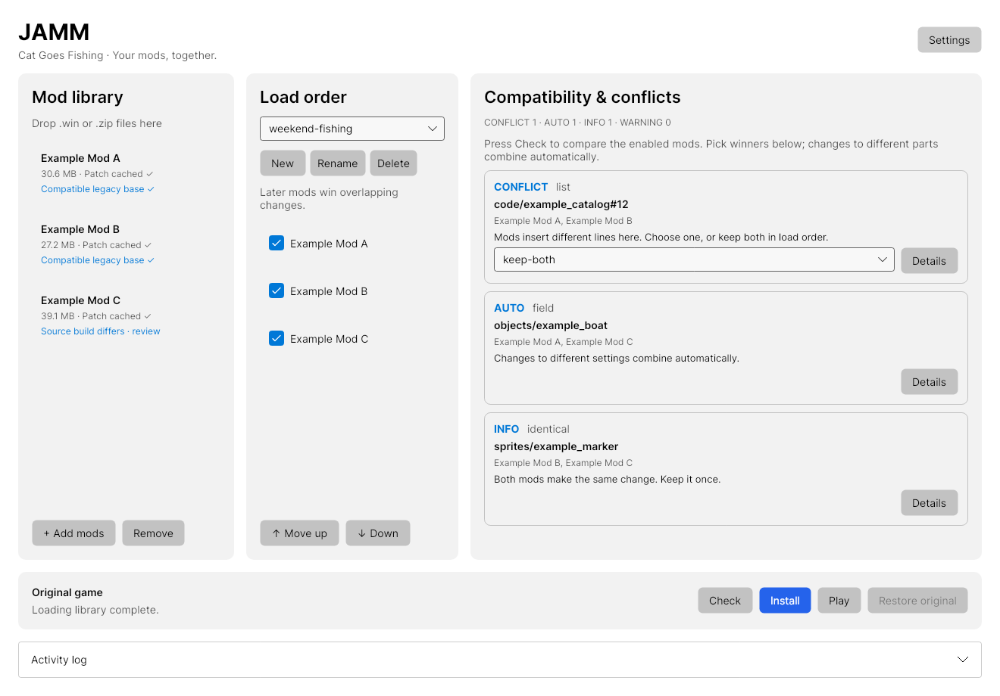

# User guide

Requires your own [legacy 2023 game and matching executable](legacy-version.md).
Install JAMM using the [short README](../README.md#install).

## GUI quick start

1. Use the [installer](../README.md#install), then open JAMM-CGF from the applications/Start menu. For a source checkout, run `dotnet run --project src/Jamm.Gui -c Release`.
2. Open **Settings**, choose a **separate copy of the complete legacy game folder**, and select the untouched base `data.win` outside that folder. The base must pass legacy bytecode validation. Set Wine or Proton there if you plan to play on Linux.
3. Drag `.win` or `.zip` mods into the library, or press **Add mods**. Zip files must contain exactly one `data.win`; other contents are never extracted or executed.
4. Create a profile, enable its mods, and arrange their order by dragging or using the arrow buttons. Later mods win overlaps by default.
5. Press **Check**. Review conflict explanations, use **Details** for local code, and save winners for individual hunks. Press **Install**, then confirm the exact destination and backup paths after verification.
6. Press **Play**. Use **Restore original** to return to the backed-up archive. The activity log explains errors and can be copied.

The desktop window and CLI use the same data directory and settings. Pass `--data-dir <directory>` to either, or set `CGFMM_DATA_DIR`. [Storage and runner settings](data-layout.md).

## Review the overlap



The GUI groups **CONFLICT**, **AUTO**, **INFO**, and **WARNING** findings. Independent code edits and structured fields combine automatically; overlapping edits offer a mod choice. List insertion hunks also offer **keep-both**, even when another hunk in the same entry needs a single winner. Details shows read-only local GML with conflict markers. Changing order or enablement clears previous choices so you can review them again.

JAMM automatically allocates distinct slots for supported fish catalog additions; no manual CatalogData Create winner is needed. General keep-both choices do not allocate other gameplay slots. Boat definitions can still conflict. [Catalog API and save migration](catalog-api.md), [conflict rules](conflicts.md).

## Safety and recovery

Input base and mod archives are opened read-only. The manager imports copies, builds a separate output, and installs through the same guarded Core service used by the CLI. It refuses an unknown installed archive, mismatched backup, or modified build. Keep your untouched source folder separate from the folder used for modded play.

Before replacement, SHA-256-verified originals are retained at `data.win.cgfmm-original` in the game folder and under the manager's `backups/` directory. Restore verifies the original hash and retains both backups. Install and restore are disabled while work is running; cancellation happens at safe checkpoints before replacement. If a game file has been changed externally, select a clean legacy copy or follow the [CLI recovery instructions](building.md#install-and-restore).

No game files are distributed. Patches, details and logs can contain local game code or strings: do not redistribute them. Static verification checks archives, references and compilation; gameplay still needs testing with the legacy executable.

## CLI quick start: six steps

1. Buy/install Cat Goes Fishing on Steam. Keep your game and mod files outside this checkout.
2. Download the complete legacy **16 August 2023** folder through Steam's console:
   `download_depot 343780 343782 9039707068725406600`.
   Follow [the legacy build guide](legacy-version.md) for download locations and ownership requirements.
3. Keep that folder as your untouched original, and copy the **whole folder**, including
   `Cat Goes Fishing.exe`, DLLs and music, to a separate location for modded play:

   ```sh
   cp -a "$HOME/Games/CGF-legacy-original" "$HOME/Games/CGF-modded"
   ```

4. Install using the [README](../README.md#install), or build from source below and configure the manager. Here `cgfmm` means
   the built executable (`src/Jamm.Cli/bin/Release/net10.0/cgfmm`), or use
   `dotnet run --project src/Jamm.Cli --` before each command:

   ```sh
   cgfmm config set base "$HOME/Games/CGF-legacy-original/data.win"
   cgfmm config set gameDir "$HOME/Games/CGF-modded"
   cgfmm config set wine.mode wine
   cgfmm config set wine.binary wine
   # Optional isolated Wine prefix:
   cgfmm config set wine.prefix "$HOME/.local/share/cgfmm/wine-prefix"
   ```

5. Add your mods (`.win` or a zip containing one nested `data.win`), create their
   load order, and select the profile. Each import computes its semantic patch:

   ```sh
   cgfmm add "$HOME/Cat-Goes-Fishing-Mods/the-abyss-beta.win" --name Abyss
   cgfmm add "$HOME/Cat-Goes-Fishing-Mods/cave-expansion.win" --name Cave
   cgfmm add "$HOME/Cat-Goes-Fishing-Mods/colour-expansion.win" --name Colour
   cgfmm list
   cgfmm profile create combined --mods Abyss,Cave,Colour
   cgfmm profile use combined
   ```

6. Apply, review the printed conflict choices, and accept installation. Then launch:

   ```sh
   cgfmm apply                  # prompts after the verified build; --yes automates acceptance
   cgfmm play                   # skips rebuilding if this exact profile is still installed
   # Return to the original later:
   cgfmm restore
   ```

   Later participating mods win overlaps by default. `profile resolve` records explicit
   asset choices; static verification still needs an in-game desktop check.

For Proton instead of Wine, configure these existing installation directories:

```sh
cgfmm config set wine.mode proton
cgfmm config set proton.path "$HOME/.steam/steam/steamapps/common/Proton - Experimental"
# Optional override; otherwise use STEAM_COMPAT_CLIENT_INSTALL_PATH or a standard Steam folder:
cgfmm config set proton.clientInstallPath "$HOME/.steam/steam"
# Optional existing directory; default compatibility data stays under the manager data directory:
cgfmm config set proton.compatDataPath /path/to/compatdata/343780
```

## Flatpak Steam

If Steam is installed as `com.valvesoftware.Steam`, start Steam before pressing Play
and select the Flatpak runner in GUI Settings or run:

```sh
cgfmm config set wine.mode proton-flatpak
cgfmm play
```

JAMM detects Steam at
`~/.var/app/com.valvesoftware.Steam/.local/share/Steam` and uses
`steamapps/common/Proton - Experimental/proton` there. Install Proton - Experimental
through Steam if it is missing. Compatibility data defaults to that Steam directory's
`steamapps/compatdata/343780`, which is visible inside the sandbox.

The runner enters the lowest-PID running Steam instance and restores its `steam.sh`
environment before starting Proton with Python. Flatpak must be on PATH and Steam
must already be running. No wrapper script is needed.

`proton.path`, `proton.clientInstallPath`, and `proton.compatDataPath` override these
defaults. If switching from a wrapper or host Proton setup, clear these optional
fields in GUI Settings to restore automatic detection, or set them to Flatpak-visible
locations with `config set`. Keep the whole legacy game folder in a location Steam
can access, such as under its Flatpak data directory or an allowed `/run/media`
location, and set `gameDir` accordingly. JAMM checks visibility from inside Steam
before installing a profile; an inaccessible folder produces instructions to move
it or grant Steam access.

## CLI at a glance

| Command | Purpose |
| --- | --- |
| `config show / set` | Base, installed folder, Wine and Proton settings |
| `add`, `list`, `remove` | Local library and patch caches |
| `profile create / use / resolve / delete` | Ordered selections and asset or hunk choices |
| `apply`, `play`, `restore` | Verified install, launch, and rollback |
| `inspect`, `compare`, `diff`, `check` | Metadata, semantic patches, and compatibility reports |
| `build`, `verify` | Explicit archive build and verification |

See the [complete CLI reference](cli.md), [patch format](patch-format.md), and [build safety details](building.md).

## FAQ

**Why does the current Steam version fail validation?** It is YYC: code lives in the executable. Known mods require the legacy VM `data.win` **and the matching old executable**. [Legacy guide](legacy-version.md).

**Why does Colour Expansion show a different-base warning?** It targets 15 August 2023; the common base is 16 August. The patch includes those differences. Matching timestamps alone never replace the complete archive hash check.

**Does verification guarantee the mods work together?** No. Dynamic resource lookups, inherited texture warnings and boat definitions need an in-game check. Fish catalog collisions are relocated automatically, including Abyss and Cave additions from `[2,58]`. Their same-name boat 8 implementations still need a conflict choice. [Save compatibility](catalog-api.md#saves-and-changing-profiles).

**How do I remove a mod used by a profile?** Delete profiles that reference it first, then remove it from the library. Disabling a mod retains its place in that profile. Source files and backups are kept.

**Can I use this on Windows?** The GUI targets Windows and Linux. Windows desktop behavior still needs desktop validation. Play currently uses the shared Wine/Proton runner configuration, including on Windows; after Install, Windows players should launch `Cat Goes Fishing.exe` manually from the configured modded game folder. There is no native Windows Play mode today.

**Where is my data?** Use `--data-dir`, `CGFMM_DATA_DIR`, or the default `$XDG_DATA_HOME/cgfmm` (`$HOME/.local/share/cgfmm`). [Layout and configuration keys](data-layout.md).

## Build from source

Requires the **.NET 10 SDK**, Git submodules, and your own game/mod files. .NET 8 is not supported by the pinned UndertaleModLib version.

```sh
git clone --recursive https://github.com/varialbe/JAMM-CGF.git
cd JAMM-CGF
git submodule update --init --recursive
dotnet build -c Release
dotnet test
dotnet run --project src/Jamm.Gui -c Release
```

Publish self-contained builds without committing their output:

```sh
dotnet publish src/Jamm.Gui -c Release -r linux-x64 --self-contained
dotnet publish src/Jamm.Gui -c Release -r win-x64 --self-contained
```

[Packaging, headless tests and screenshot regeneration](building.md#desktop-gui-builds-and-verification). The screenshot above is rendered by Avalonia with invented names and no game assets or personal paths.

| Path | Purpose |
| --- | --- |
| `src/Jamm.Core/` | Archive analysis, patches, merging, profiles and guarded installation |
| `src/Jamm.Gui/` | Avalonia 11 desktop front end, MVVM Toolkit |
| `src/Jamm.Cli/` | Thin `cgfmm` console interface |
| `tests/` | Synthetic, headless and opt-in real-file tests |
| `external/UndertaleModTool/` | Unmodified submodule pinned to 0.9.2.0 |

Read [AGENTS.md](../AGENTS.md) before contributing. Keep game data out of Git and require a zero-warning build in our projects.

## Installer updates and removal

The scripts build `main` from source with recursive pinned submodules; Git is
required on both systems, and Linux also needs curl. Downloads and .NET builds
need internet access. The GUI also needs a working desktop and its platform
libraries; Wine/Proton and Steam are separate game requirements. No admin/root
access is used. Microsoft’s SDK installer can report additional native runtime
prerequisites on minimal distributions; install those using your system package
manager if requested.

Linux source lives at `~/.local/share/jamm-cgf/src`, launchers at
`~/.local/bin`, and the menu entry at
`~/.local/share/applications/jamm-cgf.desktop`. The SDK, if needed, goes to
`~/.dotnet`. Windows uses `%LOCALAPPDATA%\jamm-cgf\src` and
`%LOCALAPPDATA%\jamm-cgf\bin`, with an SDK at
`%LOCALAPPDATA%\Microsoft\dotnet` if no .NET 10 SDK is available.
The launchers use the detected host path; no system-wide .NET is required.
Add the launcher directory to PATH yourself for terminal commands.

Re-run the same install command to update. Updates require a clean checkout on
`main` and fast-forward only; save any local changes elsewhere first. These
commands fetch the public `main` branch, so new installer changes become
available there after they have been merged.

To remove the launchers and menu entry, run the downloaded script with
`bash install.sh --uninstall` or
`powershell -NoProfile -ExecutionPolicy Bypass -File .\install.ps1 -Uninstall`.
Source/builds, the shared .NET SDK, manager profiles/mods/backups and all game
folders are retained. After saving any wanted source changes you can remove the
installer source directory manually. Restore the game in JAMM before uninstalling
if you want its original archive back.

## Performance and launch troubleshooting

- Start Steam before Play (required by the Flatpak runner and the Steam game).
  If Play reports a missing runner, install Wine or Proton and correct Settings.
  On Windows, install the profile, then launch the legacy executable manually.
- Screen lock can throttle rendering to **1 FPS**. Unlock the screen and keep the
  game visible before measuring performance; this is not a mod benchmark.
- Fullscreen 2x textures with all six mods exceeded **8 GB VRAM** in the
  orchestrator’s test. Use **HD Lite**, built without upscaled pages, when memory
  is limited. See [example mods and measurements](example-mods.md).
- Archive verification does not guarantee gameplay compatibility. Review conflicts,
  test your profile in game, and retain the clean complete legacy folder.

See also [example mods](example-mods.md), [CLI reference](cli.md),
[conflict rules](conflicts.md), and [build/recovery details](building.md).

## Browse mods

Open **Browse mods**, select a card to see images and check its content, then press
**Download**. JAMM imports the file and enables it in your active profile (creating a
default profile if needed). Green/grey **Disable/Enable** buttons control your mods.
Press **Play** to build, verify and apply changed selections before starting the game.
The first installation asks you to approve the exact game-copy and backup paths.

Cards show counts computed from the archives, rather than claims from descriptions.
A green check means the patch built and verified with matching build information;
a red cross means it cannot apply; a yellow question mark means unverified, failed
analysis, or a different source build. Hover the icon for the reason. Mods built from another
2023 legacy build whose only difference is the build timestamp count as compatible; the
tooltip names the source build.

**Advanced mode** is saved between sessions. It shows author descriptions, releases,
file choices, load order, conflicts and the existing manager actions. A unique file
from the newest release is chosen automatically; genuinely ambiguous choices require
the advanced picker. Later mods win by default; advanced conflict choices remain available.

First-run setup searches Steam libraries and depot downloads on Windows, Linux
(including Flatpak/Snap Steam) and macOS. A detected legacy game can be copied into
a separate sibling folder with one click. A bounded background search also checks mounted drives and your home folder for moved depot downloads. Add mods and Download open setup when needed and resume afterwards. If only the current game is found, copy the
legacy-depot command into Steam's console, download it, then use **Check again**
or **Choose folder…**.
Found originals are read-only; JAMM never installs into them during automatic setup.

The catalog loads on first visit; **Refresh** retries failures. Offline snapshots
show their last successful fetch time. Selection checks are cancellable and downloaded
archives/facts are cached under the selected manager data directory. Local management
works without the catalog.

Public Game Jolt project pages and direct HTTPS `.win`/`.zip` links are supported.
Unsupported hosts offer a source-page fallback in Advanced mode. Previews without a
release cannot download. SHA-256 identifies bytes, not authorship. New releases never
change existing profiles automatically. [Storage, limits and provenance](docs/data-layout.md#online-catalog-and-downloads).

Shared compatibility results: before checking a mod itself, JAMM asks
`https://varialbe.xyz/jamm/compat/v1/` whether the server already checked exactly this file
against exactly your game version (a plain HTTPS request without cookies or identifiers; the
server sees your IP like any website). Switch it off in Settings. Details: [compat-db.md](compat-db.md).

## Built-in mods

After choosing your untouched legacy base in Settings, the **Built-in (JAMM)** group
provides **JAMM Perf**, **JAMM Smooth**, **JAMM HD Lite** and **JAMM Console**.
Toggle one on to generate and import it locally, with progress and Cancel available.
It is enabled in your active profile; then use Check/Install (Advanced mode) or Play.
No terminal, SDK, downloads or game assets bundled with JAMM are needed.

- Perf: **F8** toggles the optional performance mode.
- Smooth: **F7** cycles 60/120/off.
- HD Lite: **F11** toggles fullscreen; original textures are retained.
- Console: **F12** or **backtick** opens the console. Type `help` or `unlockall`.
  Unlocks persist in your save at the next autosave or save menu.

Generated archives are cached under the manager's `builtin/` directory by base SHA-256
and generator version. Built-ins use the same merge and conflict checks as other mods.
CLI users can run `cgfmm builtin list` and `cgfmm builtin add console` (or `perf`,
`smooth`, `hd-lite`), then select the imported mod in a profile.
The [ModMaker instructions](example-mods.md) are intended for developers.
